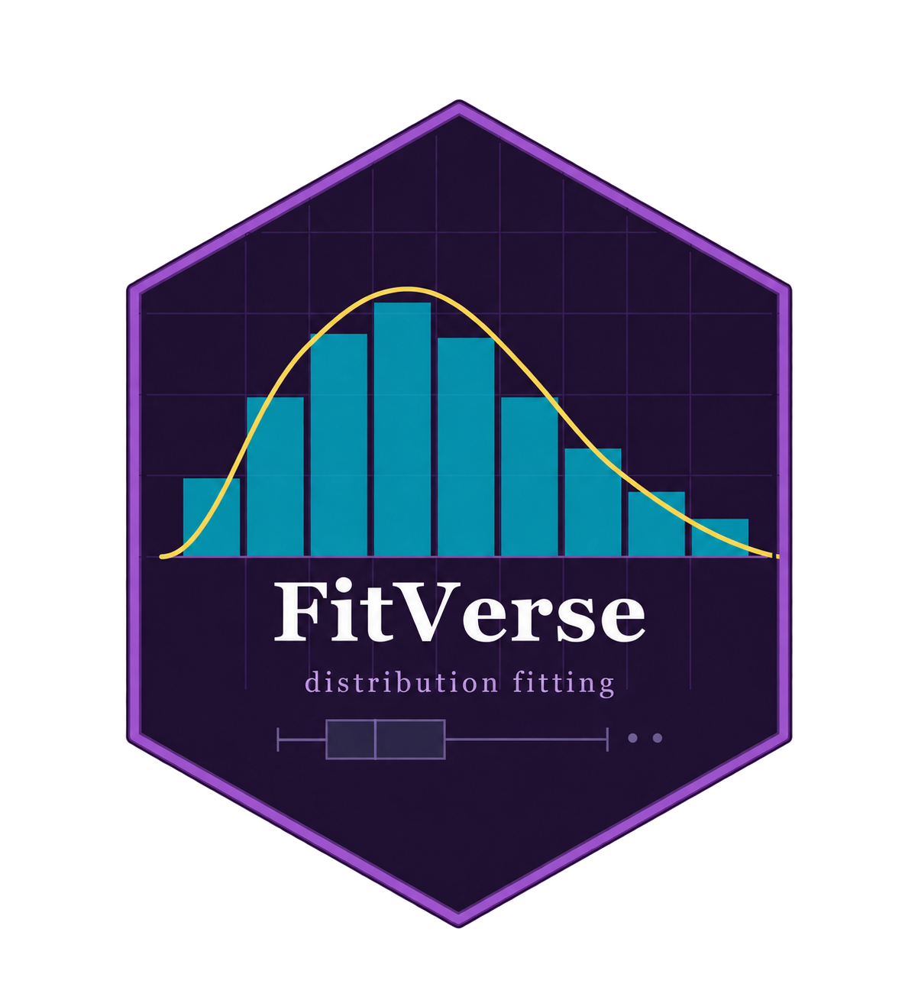

```{=html}
<style>
.pkg-hero {
  display: flex; align-items: center; gap: 28px;
  padding: 24px 28px;
  background: linear-gradient(135deg, #1F1033 0%, #2D1852 60%, #3d1f6e 100%);
  border-radius: 10px; margin-bottom: 28px; color: white;
}
.pkg-hero img { width: 110px; height: auto; flex-shrink: 0; border-radius: 6px; }
.pkg-hero h1 { margin: 0 0 4px 0; font-size: 2.4rem; font-weight: 800; color: white; letter-spacing: -0.5px; }
.pkg-hero .subtitle { font-size: 1.05rem; color: #C09AE0; margin: 0 0 10px 0; }
.pkg-hero .badges { display: flex; flex-wrap: wrap; gap: 6px; margin-top: 8px; }
.pkg-hero .badges a img, .pkg-hero .badges img { height: 22px; vertical-align: middle; border-radius: 0; width: auto; }
.pkg-hero .install-box {
  background: rgba(0,0,0,0.4); border-radius: 6px; padding: 10px 14px;
  font-family: monospace; font-size: 0.9rem; color: #00BCD4;
  margin-top: 10px; border-left: 3px solid #F7D94C;
}
.fn-card {
  border-left: 4px solid #9B59C8; padding: 12px 16px;
  background: #faf8ff; border-radius: 0 6px 6px 0; margin: 12px 0; line-height: 1.9;
}
.fn-card code { background: #ede7f6; padding: 1px 5px; border-radius: 3px; font-size: 0.88em; }
.dist-badge {
  display: inline-block; padding: 3px 9px; border-radius: 12px;
  font-size: 0.78rem; font-weight: 600; margin: 2px;
}
.dist-sym  { background: #e8eaf6; color: #3949ab; }
.dist-skew { background: #e0f7fa; color: #00695c; }
.dist-heavy{ background: #fce4ec; color: #880e4f; }
.dist-ev   { background: #fff3e0; color: #e65100; }
.dist-bnd  { background: #f1f8e9; color: #33691e; }
.method-pill {
  display: inline-flex; align-items: center; gap: 6px;
  background: #ede7f6; border-radius: 20px; padding: 6px 14px;
  margin: 4px; font-weight: 600; font-size: 0.85rem;
}
.method-pill .dot { width: 9px; height: 9px; border-radius: 50%; }
.use-grid { display: grid; grid-template-columns: repeat(auto-fit, minmax(200px, 1fr)); gap: 12px; margin: 16px 0; }
.use-card { border-radius: 8px; padding: 14px; background: white; border: 1px solid #e0d6f5; }
.use-card h4 { margin: 0 0 6px 0; font-size: 0.95rem; color: #5A2D82; }
.use-card p  { margin: 0; font-size: 0.82rem; color: #444; line-height: 1.45; }
</style>

<div class="pkg-hero">
  
  <div>
    <h1>FitVerse</h1>
    <div class="subtitle">Parametric Distribution Fitting in R</div>
    <div class="badges">
      <a href="https://cran.r-project.org/package=FitVerse"></a>
      <a href="https://cran.r-project.org/package=FitVerse"></a>
      
      
    </div>
    <div class="install-box">
      install.packages("FitVerse") &nbsp;·&nbsp; library(FitVerse)
    </div>
  </div>
</div>
```

Figuring out which distribution fits your data can take a while. Is it Gamma or Log-Normal? Maybe Weibull? Trying them one at a time is tedious, and eyeballing a histogram only gets you so far.

**FitVerse** does the searching for you. Give it your data and it fits all 52 distribution families, estimates parameters using MLE, MOM, or L-moments, ranks every fit, runs four goodness-of-fit tests, and returns a clean summary with plots. One line of code.

---

## Distributions

FitVerse covers **52 distribution families** across five groups.

::: {.panel-tabset}

### Symmetric / Unbounded

```{=html}
<span class="dist-badge dist-sym">Normal</span>
<span class="dist-badge dist-sym">Logistic</span>
<span class="dist-badge dist-sym">Cauchy</span>
<span class="dist-badge dist-sym">Laplace</span>
<span class="dist-badge dist-sym">Student-t</span>
<span class="dist-badge dist-sym">Skew-Normal</span>
<span class="dist-badge dist-sym">Generalised Normal</span>
<span class="dist-badge dist-sym">Asymmetric Laplace</span>
<span class="dist-badge dist-sym">Johnson SU</span>
<span class="dist-badge dist-sym">Normal Inverse Gaussian</span>
<span class="dist-badge dist-sym">Generalised Hyperbolic</span>
<span class="dist-badge dist-sym">Truncated Normal</span>
```

### Right-Skewed (Positive)

```{=html}
<span class="dist-badge dist-skew">Gamma</span>
<span class="dist-badge dist-skew">Log-Normal</span>
<span class="dist-badge dist-skew">Exponential</span>
<span class="dist-badge dist-skew">Weibull (2P)</span>
<span class="dist-badge dist-skew">Weibull (3P)</span>
<span class="dist-badge dist-skew">Log-Logistic</span>
<span class="dist-badge dist-skew">Inverse Gamma</span>
<span class="dist-badge dist-skew">Inverse Weibull</span>
<span class="dist-badge dist-skew">Paralogistic</span>
<span class="dist-badge dist-skew">Inverse Gaussian</span>
<span class="dist-badge dist-skew">Generalised Gamma</span>
<span class="dist-badge dist-skew">Gompertz</span>
<span class="dist-badge dist-skew">Birnbaum-Saunders</span>
<span class="dist-badge dist-skew">Rayleigh</span>
<span class="dist-badge dist-skew">Half-Normal</span>
<span class="dist-badge dist-skew">Exponentiated Weibull</span>
<span class="dist-badge dist-skew">Gamma (3P)</span>
<span class="dist-badge dist-skew">Log-Normal (3P)</span>
<span class="dist-badge dist-skew">Lindley</span>
<span class="dist-badge dist-skew">Exponentiated Exponential</span>
<span class="dist-badge dist-skew">Nakagami</span>
```

### Heavy-Tailed

```{=html}
<span class="dist-badge dist-heavy">Pareto</span>
<span class="dist-badge dist-heavy">Burr XII</span>
<span class="dist-badge dist-heavy">Lomax (Pareto Type II)</span>
<span class="dist-badge dist-heavy">Dagum</span>
<span class="dist-badge dist-heavy">GB2 (Generalised Beta of the Second Kind)</span>
```

### Extreme Value & Hydrological

```{=html}
<span class="dist-badge dist-ev">GEV</span>
<span class="dist-badge dist-ev">Gumbel</span>
<span class="dist-badge dist-ev">GPD</span>
<span class="dist-badge dist-ev">Pearson Type III</span>
<span class="dist-badge dist-ev">Log-Pearson Type III</span>
<span class="dist-badge dist-ev">Generalised Logistic</span>
<span class="dist-badge dist-ev">Kappa-4</span>
<span class="dist-badge dist-ev">Wakeby</span>
```

### Bounded / Finite Support

```{=html}
<span class="dist-badge dist-bnd">Beta</span>
<span class="dist-badge dist-bnd">Uniform</span>
<span class="dist-badge dist-bnd">Triangular</span>
<span class="dist-badge dist-bnd">Right Triangular</span>
<span class="dist-badge dist-bnd">PERT</span>
<span class="dist-badge dist-bnd">Kumaraswamy</span>
```

:::

---

## Estimation Methods

```{=html}
<span class="method-pill"><span class="dot" style="background:#9B59C8"></span>MLE — Maximum Likelihood</span>
<span class="method-pill"><span class="dot" style="background:#00BCD4"></span>MOM — Method of Moments</span>
<span class="method-pill"><span class="dot" style="background:#F7D94C"></span>LMOM — L-Moments</span>
```

| Method | Best For | Notes |
|--------|----------|-------|
| **MLE** | Most situations | Finds parameters that make observed data most probable |
| **MOM** | Quick estimates | Matches theoretical to sample moments; faster than MLE |
| **LMOM** | Hydrology; extreme values | Robust to outliers; ideal for flood peaks, rainfall maxima |

Run all three at once with `method = "ALL"`. FitVerse picks the overall best fit across all methods and distributions.

---

## Core Workflow

### Quick Start

```r
library(FitVerse)

# Built-in precip dataset: annual precipitation, 70 US cities
x <- as.numeric(precip)

# Fit all 52 distributions by MLE — ranked by AIC
fit <- fitverse(x, xlab = "Annual precipitation (inches)")
```

::: {.callout-note}
## What happens in one call
`fitverse()` fits all 52 distributions, estimates parameters, ranks by AIC, runs 4 GoF tests, and produces a two-panel diagnostic plot. It all happens automatically.
:::

### Key Arguments

```r
fitverse(x,
  dists       = "all",    # subset: c("gamma","lognormal","gev") or "all"
  method      = "MLE",    # "MLE", "MOM", "LMOM", or "ALL"
  criterion   = "AIC",    # ranking criterion: "AIC" or "BIC"
  xlab        = "x",      # axis label for plots and reports
  plot        = TRUE,     # produce diagnostic plot?
  interactive = FALSE,    # plotly interactive? (needs plotly)
  top_n       = 3,        # density curves to overlay
  verbose     = TRUE)     # print ranked table to console?
```

### The Return Object

```r
fit$best_fit     # best-fit distribution: params, AIC/BIC, GoF stats
fit$ranking      # ranked table of all 52 distributions
fit$all_fits     # full list of every fitted model object
fit$data         # original data vector
fit$data_summary # n, mean, sd, skewness, kurtosis
```

### S3 Methods

```{=html}
<div class="fn-card">
<code>print(fit)</code> — ranked table + best-fit parameters<br>
<code>summary(fit)</code> — full goodness-of-fit table<br>
<code>plot(fit)</code> — two-panel diagnostic plot<br>
<code>coef(fit)</code> — best-fit parameter vector<br>
<code>logLik(fit)</code> &nbsp; <code>AIC(fit)</code> &nbsp; <code>BIC(fit)</code><br>
<code>nobs(fit)</code> — sample size n<br>
<code>residuals(fit)</code> — probability residuals<br>
<code>fitted(fit)</code> — fitted densities at data points<br>
<code>confint(fit)</code> — Wald confidence intervals for parameters<br>
<code>vcov(fit)</code> — variance-covariance matrix<br>
<code>save_plot(fit, "fig.pdf", dpi = 600)</code> — save plot to file
</div>
```

---

## Diagnostic Plot

Every call produces a **two-panel diagnostic plot** by default.

**Left panel (Density):** histogram with the top `top_n` fitted density curves overlaid. The best-fit distribution is highlighted and its PDF formula is shown on the figure.

**Right panel (Q-Q plot):** theoretical quantiles of the best-fit distribution plotted against sample quantiles. Points close to the diagonal mean a good fit.

```r
# Interactive version (needs plotly)
fit <- fitverse(x, interactive = TRUE)

# Save without displaying
save_plot(fit, file = "precipitation_fit.png", dpi = 600)
save_plot(fit, file = "precipitation_fit.pdf")   # PDF or SVG by extension
```

::: {.callout-tip}
## L-Moment Ratio Diagram
For hydrological and extreme-value work, use the LMRD as an exploratory tool *before* fitting. It plots sample L-skewness and L-kurtosis against theoretical curves for several distribution families.
```r
lmrd(x)
```
:::

---

## Goodness-of-Fit Tests

FitVerse runs **four GoF tests automatically** on every distribution:

| Test | Abbrev. | Sensitive To |
|------|---------|-------------|
| Kolmogorov-Smirnov | KS | Overall CDF deviation |
| Anderson-Darling | AD | Tail behaviour (strong) |
| Cramer-von Mises | CvM | Overall CDF deviation |
| Chi-Squared | χ² | Binned frequency discrepancy |

```r
fit$best_fit$gof                          # GoF stats for best fit
tbl <- compare_dists(x, method = "MLE")  # ranked table only, no plot
head(tbl, 10)
```

---

## Probability Tools

```r
dfitverse(30,   fit)   # density (PDF) at x = 30
pfitverse(40,   fit)   # P(X ≤ 40)  — CDF
qfitverse(0.95, fit)   # 95th percentile
rfitverse(100,  fit)   # simulate 100 values from fitted distribution
```

Works identically for all 52 distributions — no need to know the underlying `d/p/q/r` function names.

---

## Bootstrap CIs & Return Levels

::: {.panel-tabset}

### Parameter CIs

```r
boot <- bootstrap_ci(fit, R = 500)
print(boot)
# shape: [4.12, 6.10]   rate: [0.11, 0.17]
```

### Return Levels

A *T*-year return level is the value expected to be exceeded once every *T* years on average.

```r
rl <- return_level(fit, T = c(10, 50, 100))
print(rl)
# T =  10:  49.2  [43.1, 56.2]
# T =  50:  60.9  [53.4, 69.8]
# T = 100:  65.4  [57.0, 75.9]
```

### Bootstrap CIs for Return Levels

```r
boot_rl <- bootstrap_ci(fit, R = 500,
                        return_levels = c(10, 50, 100))
print(boot_rl)
```

:::

---

## Batch Fitting

```r
results <- fitverse_batch(my_data, method = "MLE")
results$summary   # best distribution + parameters for each column
```

Fits all numeric columns of a data frame at once. Useful when you want a quick distributional overview across many variables.

---

## Report Generation

```r
generate_report(fit,
  title       = "Precipitation Data: Distribution Fitting",
  author      = "Karuna Reddy",
  output_file = "report.html")   # or "report.pdf"

# Include bootstrap results
boot <- bootstrap_ci(fit, R = 500)
generate_report(fit, boot = boot, output_file = "report.html")
```

---

## Shiny App

```r
FitVerseApp()
```

Upload a CSV, choose distributions, switch between MLE/MOM/LMOM, explore plots interactively, and download a report — no code needed.

---

## Who Is FitVerse For?

```{=html}
<div class="use-grid">
  <div class="use-card"><h4>🌊 Hydrology</h4><p>Fit GEV, Gumbel, GPD, Pearson III to flood peaks and rainfall maxima. LMOM + return levels built in.</p></div>
  <div class="use-card"><h4>📋 Actuarial Science</h4><p>Fit Pareto, Burr, GB2, Log-Normal to insurance claims, with full heavy-tail coverage.</p></div>
  <div class="use-card"><h4>📊 Survey Sampling</h4><p>Identify the distribution of a continuous survey variable before model-based estimation or simulation.</p></div>
  <div class="use-card"><h4>🎓 Teaching</h4><p>The Shiny app and clean output let students explore distribution fitting visually without writing code.</p></div>
  <div class="use-card"><h4>🔬 Research</h4><p>52 distributions · 3 methods · 4 GoF tests · Bootstrap CIs · report generation — all in one package.</p></div>
</div>
```

---

## Quick Reference

| Function | Purpose |
|----------|---------|
| `fitverse(x)` | Fit all 52 distributions, rank by AIC |
| `compare_dists(x)` | Ranked table only (no plot) |
| `lmrd(x)` | L-Moment Ratio Diagram |
| `bootstrap_ci(fit, R)` | Bootstrap CIs for parameters |
| `return_level(fit, T)` | Return level estimates |
| `dfitverse(x, fit)` | Density (PDF) |
| `pfitverse(q, fit)` | CDF |
| `qfitverse(p, fit)` | Quantile function |
| `rfitverse(n, fit)` | Simulate from fitted distribution |
| `fitverse_batch(df)` | Fit all numeric columns |
| `generate_report(fit)` | HTML / PDF analysis report |
| `FitVerseApp()` | Launch interactive Shiny app |
| `save_plot(fit, file)` | Save diagnostic plot |

---

## Citation

```r
citation("FitVerse")
```

> Reddy, K. G., & Khan, M. G. M. (2026). *FitVerse: Parametric Distribution Fitting for R*. R package version 1.0-2. <https://cran.r-project.org/package=FitVerse>

---

::: {.callout-note appearance="simple"}
FitVerse is on CRAN: <https://cran.r-project.org/package=FitVerse>  
We would love to hear how you are using it. Leave a comment or get in touch directly.
:::
