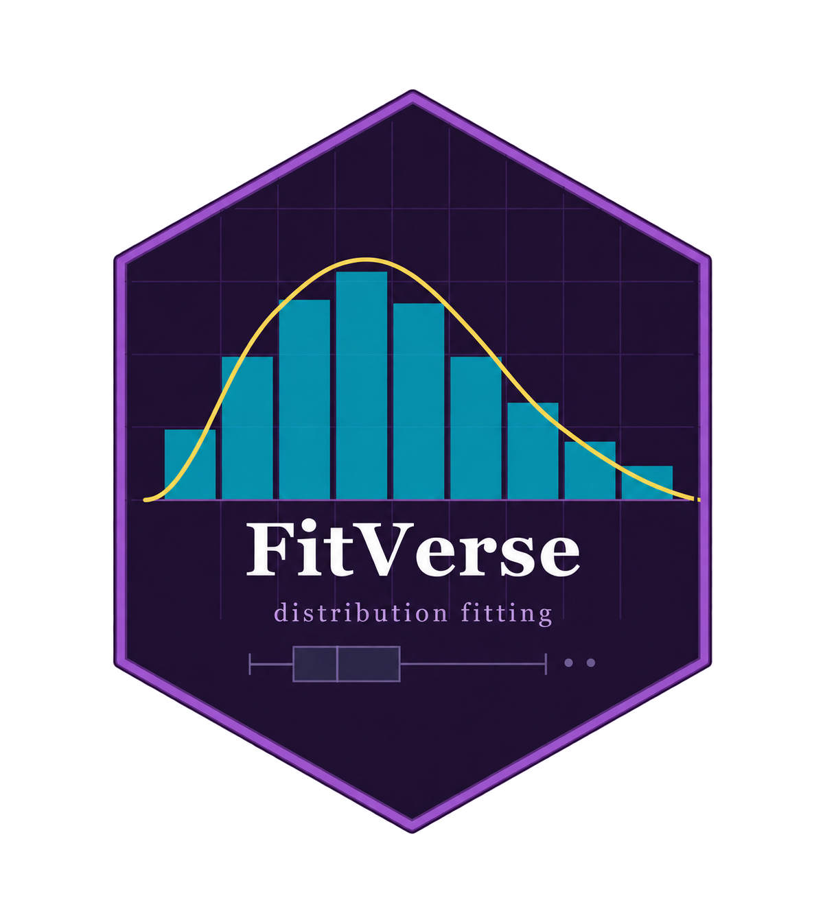

```{=html}
<style>
.pkg-hero {
  display: flex; align-items: center; gap: 28px;
  padding: 24px 28px;
  background: linear-gradient(135deg, #1F1033 0%, #2D1852 60%, #3d1f6e 100%);
  border-radius: 10px; margin-bottom: 28px; color: white;
}
.pkg-hero img { width: 110px; height: auto; flex-shrink: 0; border-radius: 6px; }
.pkg-hero h1 { margin: 0 0 4px 0; font-size: 2.4rem; font-weight: 800; color: white; letter-spacing: -0.5px; }
.pkg-hero .subtitle { font-size: 1.05rem; color: #C09AE0; margin: 0 0 10px 0; }
.pkg-hero .badges { display: flex; flex-wrap: wrap; gap: 6px; margin-top: 8px; }
.pkg-hero .badges a img, .pkg-hero .badges img { height: 22px; vertical-align: middle; border-radius: 0; width: auto; }
.pkg-hero .install-box {
  background: rgba(0,0,0,0.4); border-radius: 6px; padding: 10px 14px;
  font-family: monospace; font-size: 0.9rem; color: #00BCD4;
  margin-top: 10px; border-left: 3px solid #F7D94C;
}
.fn-card {
  border-left: 4px solid #9B59C8; padding: 12px 16px;
  background: #faf8ff; border-radius: 0 6px 6px 0; margin: 12px 0; line-height: 1.9;
}
.fn-card code { background: #ede7f6; padding: 1px 5px; border-radius: 3px; font-size: 0.88em; }
.dist-badge {
  display: inline-block; padding: 3px 9px; border-radius: 12px;
  font-size: 0.78rem; font-weight: 600; margin: 2px;
}
.dist-sym  { background: #e8eaf6; color: #3949ab; }
.dist-skew { background: #e0f7fa; color: #00695c; }
.dist-heavy{ background: #fce4ec; color: #880e4f; }
.dist-ev   { background: #fff3e0; color: #e65100; }
.dist-bnd  { background: #f1f8e9; color: #33691e; }
.method-pill {
  display: inline-flex; align-items: center; gap: 6px;
  background: #ede7f6; border-radius: 20px; padding: 6px 14px;
  margin: 4px; font-weight: 600; font-size: 0.85rem;
}
.method-pill .dot { width: 9px; height: 9px; border-radius: 50%; }
.use-grid { display: grid; grid-template-columns: repeat(auto-fit, minmax(200px, 1fr)); gap: 12px; margin: 16px 0; }
.use-card { border-radius: 8px; padding: 14px; background: white; border: 1px solid #e0d6f5; }
.use-card h4 { margin: 0 0 6px 0; font-size: 0.95rem; color: #5A2D82; }
.use-card p  { margin: 0; font-size: 0.82rem; color: #444; line-height: 1.45; }
</style>

<div class="pkg-hero">
  
  <div>
    <h1>FitVerse</h1>
    <div class="subtitle">Parametric Distribution Fitting in R</div>
    <div class="badges">
      <a href="https://cran.r-project.org/package=FitVerse"></a>
      <a href="https://cran.r-project.org/package=FitVerse"></a>
      = 3)"/>
      
    </div>
    <div class="install-box">
      install.packages("FitVerse") &nbsp;·&nbsp; library(FitVerse)
    </div>
  </div>
</div>
```

Figuring out which distribution fits your data can take a while. Is it Gamma or Log-Normal? Maybe Weibull? Trying them one at a time is tedious, and eyeballing a histogram only gets you so far.

**FitVerse** does the searching for you. Give it your data and it fits every distribution family that suits the chosen method, estimates the parameters by MLE, MOM or L-moments, ranks the fits, runs four goodness-of-fit tests, and returns a clean summary with plots. One line of code.

Version 1.0-3 is now on CRAN. The source code is on GitHub at <https://github.com/karunaredz/FitVerse>.

---

## Installation

```r
# From CRAN
install.packages("FitVerse")

# Development version from GitHub
# install.packages("remotes")
remotes::install_github("karunaredz/FitVerse")
```

---

## What Is New in Version 1.0-3

- `summary()` now returns a `fitverse_summary` object with its own `print()` method. It shows the data summary, the best fit and the top ten models in the ranking.
- A new accessor, `ranking()`, returns the full ranking table, so you no longer need to reach into the fitted object.
- Every function, including the internal helpers, now has its own help page.
- The NAMESPACE is now generated from the code documentation, so the exports and S3 methods stay in step with the code.
- A replication script that runs the main examples ships with the package. Find it with `system.file("replication.R", package = "FitVerse")`.

---

## Distributions

FitVerse covers **52 distribution families** in six groups. You can see the full list, and which methods each family supports, with `fitverse_distributions()`.

::: {.panel-tabset}

### Symmetric

```{=html}
<span class="dist-badge dist-sym">Normal</span>
<span class="dist-badge dist-sym">Logistic</span>
<span class="dist-badge dist-sym">Laplace</span>
<span class="dist-badge dist-sym">Student-t (Location-Scale)</span>
<span class="dist-badge dist-sym">Generalised Normal</span>
<span class="dist-badge dist-sym">Normal Inverse Gaussian</span>
<span class="dist-badge dist-sym">Generalised Hyperbolic</span>
<span class="dist-badge dist-sym">Truncated Normal</span>
```

### Asymmetric

```{=html}
<span class="dist-badge dist-sym">Skew-Normal</span>
<span class="dist-badge dist-sym">Johnson SU</span>
<span class="dist-badge dist-sym">Asymmetric Laplace</span>
```

### Right-Skewed

```{=html}
<span class="dist-badge dist-skew">Log-Normal</span>
<span class="dist-badge dist-skew">Gamma</span>
<span class="dist-badge dist-skew">Exponential</span>
<span class="dist-badge dist-skew">Weibull (2P)</span>
<span class="dist-badge dist-skew">Weibull (3P)</span>
<span class="dist-badge dist-skew">Log-Logistic</span>
<span class="dist-badge dist-skew">Inverse Gamma</span>
<span class="dist-badge dist-skew">Inverse Weibull</span>
<span class="dist-badge dist-skew">Paralogistic</span>
<span class="dist-badge dist-skew">Pearson Type III</span>
<span class="dist-badge dist-skew">Log-Pearson Type III</span>
<span class="dist-badge dist-skew">Inverse Gaussian</span>
<span class="dist-badge dist-skew">Generalised Gamma</span>
<span class="dist-badge dist-skew">Gompertz</span>
<span class="dist-badge dist-skew">Birnbaum-Saunders</span>
<span class="dist-badge dist-skew">Rayleigh</span>
<span class="dist-badge dist-skew">Half-Normal</span>
<span class="dist-badge dist-skew">Exponentiated Weibull</span>
<span class="dist-badge dist-skew">Gamma (3P)</span>
<span class="dist-badge dist-skew">Log-Normal (3P)</span>
<span class="dist-badge dist-skew">Lindley</span>
<span class="dist-badge dist-skew">Exponentiated Exponential</span>
<span class="dist-badge dist-skew">Nakagami</span>
```

### Heavy-Tailed

```{=html}
<span class="dist-badge dist-heavy">Cauchy</span>
<span class="dist-badge dist-heavy">Pareto</span>
<span class="dist-badge dist-heavy">Burr XII</span>
<span class="dist-badge dist-heavy">Lomax (Pareto Type II)</span>
<span class="dist-badge dist-heavy">GB2 (Generalised Beta of the Second Kind)</span>
<span class="dist-badge dist-heavy">Dagum</span>
```

### Extreme Value

```{=html}
<span class="dist-badge dist-ev">Gumbel</span>
<span class="dist-badge dist-ev">GEV</span>
<span class="dist-badge dist-ev">Generalised Pareto</span>
<span class="dist-badge dist-ev">Generalised Logistic</span>
<span class="dist-badge dist-ev">Kappa-4</span>
<span class="dist-badge dist-ev">Wakeby</span>
```

### Bounded

```{=html}
<span class="dist-badge dist-bnd">Beta</span>
<span class="dist-badge dist-bnd">Uniform</span>
<span class="dist-badge dist-bnd">Triangular</span>
<span class="dist-badge dist-bnd">Right Triangular</span>
<span class="dist-badge dist-bnd">PERT</span>
<span class="dist-badge dist-bnd">Kumaraswamy</span>
```

:::

```r
d <- fitverse_distributions()
head(d)
#          Key        Name     Family Package MLE MOM LMOM
# 1     normal      Normal  Symmetric   stats Yes Yes  Yes
# 2   logistic    Logistic  Symmetric   stats Yes Yes  Yes
# 3 skewnormal Skew-Normal Asymmetric      sn Yes   -    -
```

---

## Estimation Methods

```{=html}
<span class="method-pill"><span class="dot" style="background:#9B59C8"></span>MLE: Maximum Likelihood</span>
<span class="method-pill"><span class="dot" style="background:#00BCD4"></span>MOM: Method of Moments</span>
<span class="method-pill"><span class="dot" style="background:#F7D94C"></span>LMOM: L-Moments</span>
```

| Method | Families | Best For | Notes |
|--------|----------|----------|-------|
| **MLE** | 51 | Most situations | Finds the parameters that make the observed data most probable |
| **MOM** | 31 | Quick estimates | Matches theoretical moments to sample moments |
| **LMOM** | 15 | Hydrology and extreme values | Robust to outliers; well suited to flood peaks and rainfall maxima |

Wakeby is fitted by L-moments only. To run all three methods at once, use `method = c("MLE", "MOM", "LMOM")`. FitVerse then ranks every distribution and method pair together and picks the overall best fit.

---

## Core Workflow

### Quick Start

```r
library(FitVerse)

# Built-in precip data: average annual precipitation in 70 US cities
x <- as.numeric(precip)

# Fit every family by MLE and rank the fits by AIC
fit <- fitverse(x, xlab = "Annual precipitation (inches)")

head(ranking(fit)[, c("Rank", "Distribution", "Method", "AIC", "Delta_AIC", "KS_p", "AD_p")], 5)
#  Rank          Distribution Method      AIC Delta_AIC   KS_p   AD_p
#     1                 Dagum    MLE 564.7508    0.0000 0.4423 0.5683
#     2                  PERT    MLE 565.7535    1.0027 0.1349 0.2269
#     3      Truncated Normal    MLE 566.2037    1.4529 0.2060 0.1311
#     4     Generalised Gamma    MLE 566.5333    1.7825 0.3460 0.4548
#     5 Exponentiated Weibull    MLE 566.7180    1.9672 0.3368 0.4421
```

::: {.callout-note}
## What happens in one call
`fitverse()` fits every family that supports the chosen method, estimates the parameters, ranks the fits by AIC, runs four goodness-of-fit tests, and draws a two-panel diagnostic plot.
:::

### Key Arguments

```r
fitverse(x,
  dists       = "all",    # a subset, e.g. c("gamma", "lognormal", "gev"), or "all"
  method      = "MLE",    # "MLE", "MOM", "LMOM", or several, e.g. c("MLE", "LMOM")
  criterion   = "AIC",    # ranking criterion: "AIC" or "BIC"
  xlab        = "x",      # axis label for plots and reports
  plot        = TRUE,     # draw the diagnostic plot?
  interactive = FALSE,    # interactive plotly version? (needs plotly)
  top_n       = 3,        # number of density curves to overlay
  verbose     = TRUE)     # print the results to the console?
```

### Working With the Result

```r
ranking(fit)          # ranked table of all fitted models
coef(fit)             # best-fit parameter estimates
fit$best_fit          # best fit: parameters, log-likelihood, AIC, BIC, GoF tests
fit$all_fits          # every fitted model
fit$data_summary      # n, mean, sd, skewness, kurtosis, range
```

### S3 Methods

```{=html}
<div class="fn-card">
<code>print(fit)</code>: best-fit distribution, parameters and GoF tests<br>
<code>summary(fit)</code>: data summary, best fit and the top ten models<br>
<code>plot(fit)</code>: two-panel diagnostic plot<br>
<code>ranking(fit)</code>: full ranking table<br>
<code>coef(fit)</code>: best-fit parameter vector<br>
<code>logLik(fit)</code> &nbsp; <code>AIC(fit)</code> &nbsp; <code>BIC(fit)</code><br>
<code>as.list(fit)</code> &nbsp; <code>to_json(fit)</code>: for use in other tools and web apps<br>
<code>save_plot(fit, "fig.pdf", dpi = 600)</code>: save the plot to a file
</div>
```

---

## Diagnostic Plot

Every call draws a **two-panel diagnostic plot** by default.

**Left panel (density):** a histogram with the top `top_n` fitted density curves overlaid. The best-fit distribution is highlighted and its PDF formula is shown on the figure.

**Right panel (Q-Q plot):** theoretical quantiles of the best-fit distribution against the sample quantiles. Points close to the diagonal mean a good fit.

```r
# Interactive version (needs plotly)
fit <- fitverse(x, interactive = TRUE)

# Save without displaying
save_plot(fit, file = "precipitation_fit.png", dpi = 600)
save_plot(fit, file = "precipitation_fit.pdf")   # PNG, PDF or SVG by extension
```

::: {.callout-tip}
## L-Moment Ratio Diagram
For hydrological and extreme-value work, use the L-moment ratio diagram as an exploratory tool *before* fitting. It plots the sample L-skewness and L-kurtosis against the theoretical curves of several families.
```r
lmrd(x)
```
:::

---

## Goodness-of-Fit Tests

FitVerse runs **four goodness-of-fit tests** on every fitted distribution:

| Test | Abbrev. | Sensitive To |
|------|---------|-------------|
| Kolmogorov-Smirnov | KS | Overall CDF deviation |
| Anderson-Darling | AD | Tail behaviour (strong) |
| Cramer-von Mises | CvM | Overall CDF deviation |
| Chi-Squared | χ² | Binned frequency discrepancy |

```r
fit$best_fit$gof                                          # GoF tests for the best fit
tbl <- compare_dists(x, method = "MLE", verbose = FALSE)  # ranking table only, no plot
head(tbl, 10)
```

---

## Probability Tools

```r
dfitverse(30,   fit)   # density (PDF) at x = 30
pfitverse(40,   fit)   # P(X <= 40), the CDF
qfitverse(0.95, fit)   # 95th percentile
rfitverse(100,  fit)   # simulate 100 values from the fitted distribution
```

These work the same way for all 52 families, so you do not need to know the underlying `d/p/q/r` function names.

---

## Bootstrap CIs and Return Levels

Here we use the annual maximum flows of the Rewa River at Navolau, Fiji (75 years), which ship with the package.

```r
q <- read.csv(system.file("extdata", "annual_max_flows.csv", package = "FitVerse"),
              comment.char = "#")$peak_flow_m3s

ff <- fitverse(q, dists = c("gev", "gumbel", "pearson3", "glo"),
               method = "LMOM", xlab = "Annual maximum flow (m3/s)")
coef(ff)
#      loc    scale
# 432.0250 104.7218
```

The Gumbel distribution fits best here.

::: {.panel-tabset}

### Return Levels

A *T*-year return level is the value exceeded once every *T* years on average.

```r
return_level(ff, return_periods = c(10, 50, 100))
#   return_period exceedance_prob return_level
# 1            10            0.10     667.6874
# 2            50            0.02     840.6429
# 3           100            0.01     913.7607
```

### Bootstrap CIs

```r
boot <- bootstrap_ci(ff, B = 500, return_periods = c(10, 50, 100), seed = 2026)
boot
# Parameters:
#  param estimate   lower  upper
#    loc   432.02 406.934 461.64
#  scale   104.72  84.378 123.48
#
# Return levels:
#    T return_level  lower   upper
#   10       667.69 614.20  723.68
#   50       840.64 754.72  927.34
#  100       913.76 814.35 1013.84
```

:::

To choose a threshold for a peaks-over-threshold analysis, `ev_threshold(q)` draws the mean residual life plot and the stability plots of the generalised Pareto parameters.

---

## Grouped Data

When you only have a frequency table, use `fitverse_grouped()` with the class midpoints and counts, or with the class limits.

```r
g <- read.csv(system.file("extdata", "rainfall_grouped.csv", package = "FitVerse"),
              comment.char = "#")
gf <- fitverse_grouped(midpoints = g$midpoint, counts = g$count,
                       dists = c("gev", "gumbel", "gamma", "lognormal", "weibull"),
                       xlab = "Annual maximum rainfall (mm)")
gf
```

---

## Batch Fitting

```r
results <- fitverse_batch(my_data, method = "MLE")
results$summary   # best distribution and its parameters for each column
```

This fits every numeric column of a data frame in one go and skips the others. It is useful when you want a quick distributional overview of many variables.

---

## Report Generation

```r
generate_report(fit,
  title       = "Precipitation Data: Distribution Fitting",
  author      = "Karuna Reddy",
  output_file = "report.html")   # or "report.pdf"

# Include the bootstrap results
boot <- bootstrap_ci(fit, B = 500)
generate_report(fit, boot = boot, output_file = "report.html")
```

---

## Shiny App

```r
FitVerseApp()
```

Upload a CSV file, choose the distributions, switch between MLE, MOM and L-moments, explore the plots, and download a report, all without writing any code. The example data in the package are ready to upload: `system.file("extdata", package = "FitVerse")`.

---

## Who Is FitVerse For?

```{=html}
<div class="use-grid">
  <div class="use-card"><h4>🌊 Hydrology</h4><p>Fit GEV, Gumbel, GPD and Pearson III to flood peaks and rainfall maxima. L-moments and return levels are built in.</p></div>
  <div class="use-card"><h4>📋 Actuarial Science</h4><p>Fit Pareto, Burr, GB2 and Log-Normal to insurance claims, with full heavy-tail coverage.</p></div>
  <div class="use-card"><h4>📊 Survey Sampling</h4><p>Identify the distribution of a continuous survey variable before model-based estimation or simulation.</p></div>
  <div class="use-card"><h4>🎓 Teaching</h4><p>The Shiny app and clean output let students explore distribution fitting visually without writing code.</p></div>
  <div class="use-card"><h4>🔬 Research</h4><p>52 distributions, 3 methods, 4 GoF tests, bootstrap CIs and reports, all in one package.</p></div>
</div>
```

---

## Quick Reference

| Function | Purpose |
|----------|---------|
| `fitverse(x)` | Fit and rank the distributions |
| `ranking(fit)` | Full ranking table |
| `compare_dists(x)` | Ranking table only (no plot) |
| `fitverse_distributions()` | List the 52 families and their methods |
| `lmrd(x)` | L-moment ratio diagram |
| `bootstrap_ci(fit, B)` | Bootstrap CIs for parameters and return levels |
| `return_level(fit, return_periods)` | Return level estimates |
| `ev_threshold(x)` | Threshold choice for peaks over threshold |
| `fitverse_grouped(...)` | Fit grouped (frequency table) data |
| `dfitverse(x, fit)` | Density (PDF) |
| `pfitverse(q, fit)` | CDF |
| `qfitverse(p, fit)` | Quantile function |
| `rfitverse(n, fit)` | Simulate from the fitted distribution |
| `fitverse_batch(df)` | Fit all numeric columns |
| `generate_report(fit)` | HTML or PDF analysis report |
| `FitVerseApp()` | Launch the interactive Shiny app |
| `save_plot(fit, file)` | Save the diagnostic plot |

---

## Citation

```r
citation("FitVerse")
```

> Reddy, K. G., & Khan, M. G. M. (2026). *FitVerse: Parametric Distribution Fitting and Analysis*. R package version 1.0-3. <https://CRAN.R-project.org/package=FitVerse>

---

::: {.callout-note appearance="simple"}
FitVerse is on CRAN: <https://CRAN.R-project.org/package=FitVerse>
Source code and issues: <https://github.com/karunaredz/FitVerse>
We would love to hear how you are using it. Leave a comment or get in touch directly.
:::
